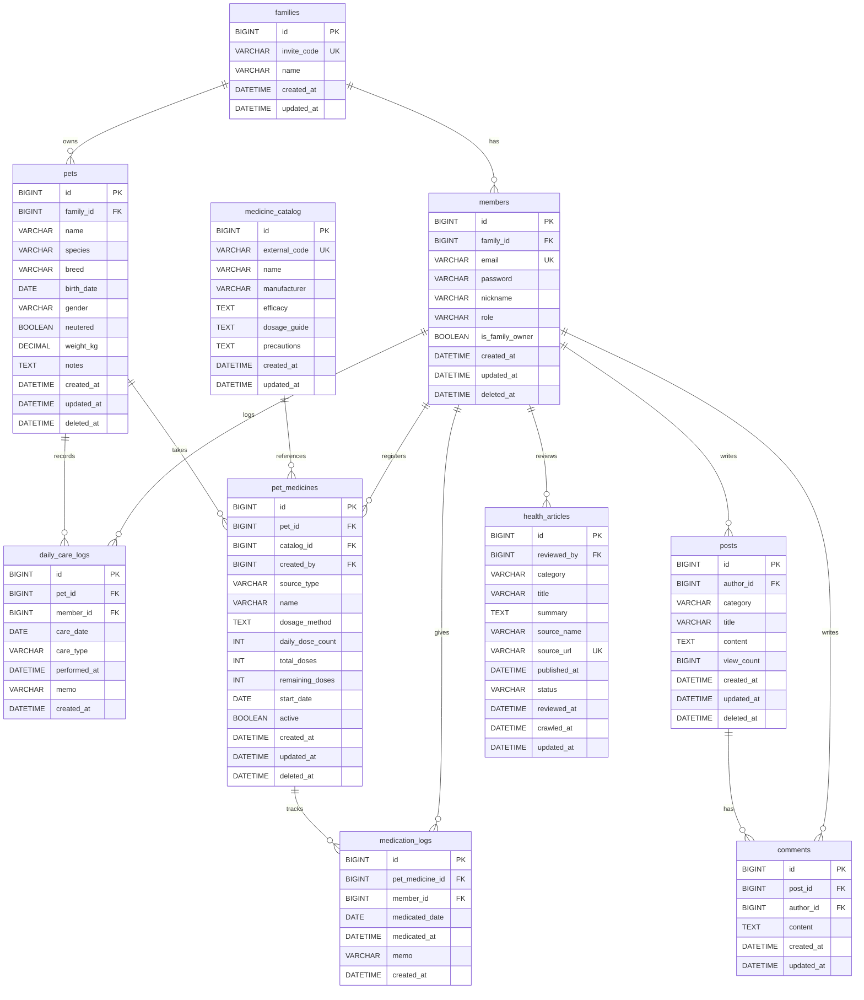

# PetCare DB 설계서 (MariaDB + Redis)

> [DESIGN.md](file:///c:/Users/송희원/Desktop/petCare/docs/DESIGN.md)의 요구사항을 기반으로 작성된 **물리 DB 설계서**입니다.  
> Step 1~7 개발 시 **Flyway 마이그레이션 SQL**과 **JPA Entity** 작성의 기준 문서로 사용합니다.

---

## 1. DB 공통 규칙 (MariaDB)

| 항목 | 규칙 | 이유 |
| --- | --- | --- |
| DBMS / 엔진 | MariaDB 11.x / `InnoDB` | 트랜잭션 및 외래키(FK) 무결성 지원 |
| 문자셋 / 콜레이션 | `utf8mb4` / `utf8mb4_unicode_ci` | 한글 및 이모지(🐾 등) 완벽 저장 |
| 타임존 | `Asia/Seoul` (KST) | 당일 산책·식사·투약 날짜 기준(`care_date`, `medicated_date`) 일관성 유지 |
| PK 전략 | `BIGINT AUTO_INCREMENT` | JPA `GenerationType.IDENTITY`와 가장 안정적 호환 |
| Enum 컬럼 | MariaDB `ENUM` 대신 `VARCHAR(30)` 사용 | 추후 Enum 값 추가 시 테이블 락(`ALTER TABLE`) 방지, `@Enumerated(EnumType.STRING)` 매핑 |
| 시간 컬럼 | `DATETIME(6)` | Java `LocalDateTime` 정밀도 유지 |
| 불리언 컬럼 | `TINYINT(1)` (`NOT NULL DEFAULT 0`) | MariaDB/Hibernate 표준 매핑 |
| 스키마 관리 | **Flyway** (`db/migration/V{n}__*.sql`) + JPA `ddl-auto: validate` | 운영 배포 시 안전한 버전별 DDL 이력 관리 |

---

## 2. 전체 ERD (Entity Relationship Diagram)

> *(Step 7 확장 시 추가 예정)* `ai_food_qa_logs` (`id`, `member_id`, `pet_id`, `species`, `question`, `verdict`, `reason`, `tip`, `created_at`)

---

## 3. 테이블별 물리 명세 (MariaDB)

### 3-1. `families` (가족 그룹)
| 컬럼명 | 물리 타입 | 제약조건 | 설명 |
| --- | --- | --- | --- |
| `id` | `BIGINT` | `PK, AUTO_INCREMENT` | 가족 그룹 ID |
| `invite_code` | `VARCHAR(20)` | `NOT NULL, UNIQUE` | 가족 고유 초대 번호 (예: `PET-7K4M9Q`) |
| `name` | `VARCHAR(50)` | `NULL` | 가족 별칭 (예: `초코네 가족`) |
| `created_at` | `DATETIME(6)` | `NOT NULL` | 생성 일시 |
| `updated_at` | `DATETIME(6)` | `NOT NULL` | 수정 일시 |

### 3-2. `members` (사용자)
| 컬럼명 | 물리 타입 | 제약조건 | 설명 |
| --- | --- | --- | --- |
| `id` | `BIGINT` | `PK, AUTO_INCREMENT` | 회원 ID |
| `family_id` | `BIGINT` | `NULL, FK -> families(id)` | 소속 가족 ID (관리자 전용 계정은 `NULL` 허용) |
| `email` | `VARCHAR(100)` | `NOT NULL, UNIQUE` | 로그인 이메일 |
| `password` | `VARCHAR(255)` | `NOT NULL` | BCrypt 암호화 비밀번호 |
| `nickname` | `VARCHAR(30)` | `NOT NULL` | 가족 내 표시 이름 (예: `엄마`, `희원`) |
| `role` | `VARCHAR(20)` | `NOT NULL DEFAULT 'USER'` | `USER`, `ADMIN` |
| `is_family_owner` | `TINYINT(1)` | `NOT NULL DEFAULT 0` | 최초 가족 생성자 여부 |
| `created_at` | `DATETIME(6)` | `NOT NULL` | 가입 일시 |
| `updated_at` | `DATETIME(6)` | `NOT NULL` | 수정 일시 |
| `deleted_at` | `DATETIME(6)` | `NULL` | 탈퇴 일시 (Soft Delete) |

### 3-3. `pets` (반려동물)
| 컬럼명 | 물리 타입 | 제약조건 | 설명 |
| --- | --- | --- | --- |
| `id` | `BIGINT` | `PK, AUTO_INCREMENT` | 반려동물 ID |
| `family_id` | `BIGINT` | `NOT NULL, FK -> families(id)` | 소속 가족 ID |
| `name` | `VARCHAR(50)` | `NOT NULL` | 반려동물 이름 |
| `species` | `VARCHAR(20)` | `NOT NULL` | `DOG`, `CAT`, `ETC` |
| `breed` | `VARCHAR(50)` | `NULL` | 품종 |
| `birth_date` | `DATE` | `NULL` | 생년월일 |
| `gender` | `VARCHAR(20)` | `NOT NULL DEFAULT 'UNKNOWN'` | `MALE`, `FEMALE`, `UNKNOWN` |
| `neutered` | `TINYINT(1)` | `NOT NULL DEFAULT 0` | 중성화 여부 |
| `weight_kg` | `DECIMAL(5,2)` | `NULL` | 몸무게 (예: `4.35` kg) |
| `notes` | `TEXT` | `NULL` | 알레르기·지병·특이사항 (Step 7 AI 프롬프트에 활용) |
| `created_at` | `DATETIME(6)` | `NOT NULL` | 등록 일시 |
| `updated_at` | `DATETIME(6)` | `NOT NULL` | 수정 일시 |
| `deleted_at` | `DATETIME(6)` | `NULL` | 삭제 일시 (Soft Delete) |

### 3-4. `daily_care_logs` (당일 산책·식사·간식 기록)
| 컬럼명 | 물리 타입 | 제약조건 | 설명 |
| --- | --- | --- | --- |
| `id` | `BIGINT` | `PK, AUTO_INCREMENT` | 케어 기록 ID |
| `pet_id` | `BIGINT` | `NOT NULL, FK -> pets(id)` | 대상 반려동물 ID |
| `member_id` | `BIGINT` | `NOT NULL, FK -> members(id)` | 기록한 가족 구성원 ID |
| `care_date` | `DATE` | `NOT NULL` | 기록 날짜 (KST 기준 `YYYY-MM-DD`) |
| `care_type` | `VARCHAR(20)` | `NOT NULL` | `WALK`, `MEAL`, `SNACK` |
| `performed_at` | `DATETIME(6)` | `NOT NULL` | 실제 수행 시각 |
| `memo` | `VARCHAR(200)` | `NULL` | 간단 메모 (예: `산책 30분`, `저녁 사료 50g`) |
| `created_at` | `DATETIME(6)` | `NOT NULL` | 생성 일시 |

### 3-5. `medicine_catalog` (동물용 의약품 마스터)
| 컬럼명 | 물리 타입 | 제약조건 | 설명 |
| --- | --- | --- | --- |
| `id` | `BIGINT` | `PK, AUTO_INCREMENT` | 카탈로그 ID |
| `external_code` | `VARCHAR(100)` | `NOT NULL, UNIQUE` | 공공데이터 품목허가번호 등 고유 코드 |
| `name` | `VARCHAR(150)` | `NOT NULL` | 제품명 |
| `manufacturer` | `VARCHAR(100)` | `NULL` | 제조/수입 업체명 |
| `efficacy` | `TEXT` | `NULL` | 효능·효과 |
| `dosage_guide` | `TEXT` | `NULL` | 기본 용법·용량 안내 |
| `precautions` | `TEXT` | `NULL` | 주의사항 |
| `created_at` | `DATETIME(6)` | `NOT NULL` | 적재 일시 |
| `updated_at` | `DATETIME(6)` | `NOT NULL` | 갱신 일시 |

### 3-6. `pet_medicines` (반려동물별 등록 약)
| 컬럼명 | 물리 타입 | 제약조건 | 설명 |
| --- | --- | --- | --- |
| `id` | `BIGINT` | `PK, AUTO_INCREMENT` | 등록 약 ID |
| `pet_id` | `BIGINT` | `NOT NULL, FK -> pets(id)` | 대상 반려동물 ID |
| `catalog_id` | `BIGINT` | `NULL, FK -> medicine_catalog(id)` | 카탈로그 연동 시 참조 (직접 등록은 `NULL`) |
| `created_by` | `BIGINT` | `NOT NULL, FK -> members(id)` | 등록한 가족 구성원 ID |
| `source_type` | `VARCHAR(20)` | `NOT NULL` | `API`(카탈로그 검색), `CUSTOM`(직접 등록) |
| `name` | `VARCHAR(150)` | `NOT NULL` | 약 이름 |
| `dosage_method` | `TEXT` | `NOT NULL` | 사용자가 작성한 급여 방법 |
| `daily_dose_count` | `INT` | `NOT NULL DEFAULT 1` | 1일 급여 횟수 (`>= 1`) |
| `total_doses` | `INT` | `NOT NULL` | 총 처방 횟수 (`>= 1`) |
| `remaining_doses` | `INT` | `NOT NULL` | 현재 남은 횟수 (`>= 0`) |
| `start_date` | `DATE` | `NOT NULL` | 복용 시작일 |
| `active` | `TINYINT(1)` | `NOT NULL DEFAULT 1` | 현재 복용 중 여부 |
| `created_at` | `DATETIME(6)` | `NOT NULL` | 등록 일시 |
| `updated_at` | `DATETIME(6)` | `NOT NULL` | 수정 일시 |
| `deleted_at` | `DATETIME(6)` | `NULL` | 삭제 일시 (Soft Delete) |

### 3-7. `medication_logs` (당일 투약 기록)
| 컬럼명 | 물리 타입 | 제약조건 | 설명 |
| --- | --- | --- | --- |
| `id` | `BIGINT` | `PK, AUTO_INCREMENT` | 투약 기록 ID |
| `pet_medicine_id` | `BIGINT` | `NOT NULL, FK -> pet_medicines(id)` | 대상 약 ID |
| `member_id` | `BIGINT` | `NOT NULL, FK -> members(id)` | 투약한 가족 구성원 ID |
| `medicated_date` | `DATE` | `NOT NULL` | 투약 날짜 (KST 기준) |
| `medicated_at` | `DATETIME(6)` | `NOT NULL` | 실제 투약 시각 |
| `memo` | `VARCHAR(200)` | `NULL` | 메모 |
| `created_at` | `DATETIME(6)` | `NOT NULL` | 생성 일시 |

### 3-8. `posts` & `comments` (정보 공유 게시판)
- **`posts`**: `id (BIGINT PK)`, `author_id (BIGINT FK -> members)`, `category (VARCHAR(30): INFO/QUESTION/REVIEW/FREE)`, `title (VARCHAR(150))`, `content (TEXT)`, `view_count (BIGINT DEFAULT 0)`, `created_at`, `updated_at`, `deleted_at`
- **`comments`**: `id (BIGINT PK)`, `post_id (BIGINT FK -> posts)`, `author_id (BIGINT FK -> members)`, `content (TEXT)`, `created_at`, `updated_at`

### 3-9. `health_articles` (크롤링 질병·신약·건강 정보)
| 컬럼명 | 물리 타입 | 제약조건 | 설명 |
| --- | --- | --- | --- |
| `id` | `BIGINT` | `PK, AUTO_INCREMENT` | 기사 ID |
| `reviewed_by` | `BIGINT` | `NULL, FK -> members(id)` | 승인/반려 처리한 관리자 ID |
| `category` | `VARCHAR(30)` | `NOT NULL` | `DISEASE`, `NEW_DRUG`, `HEALTH_CARE` |
| `title` | `VARCHAR(255)` | `NOT NULL` | 제목 |
| `summary` | `TEXT` | `NULL` | 요약 내용 (관리자 수정 가능) |
| `source_name` | `VARCHAR(100)` | `NULL` | 출처 매체/기관명 |
| `source_url` | `VARCHAR(500)` | `NOT NULL, UNIQUE` | 원문 URL (중복 수집 방지) |
| `published_at` | `DATETIME(6)` | `NULL` | 원문 발행일 |
| `status` | `VARCHAR(20)` | `NOT NULL DEFAULT 'PENDING'` | `PENDING`, `APPROVED`, `REJECTED` |
| `reviewed_at` | `DATETIME(6)` | `NULL` | 관리자 검수 일시 |
| `crawled_at` | `DATETIME(6)` | `NOT NULL` | 크롤링 수집 일시 |
| `updated_at` | `DATETIME(6)` | `NOT NULL` | 수정 일시 |

---

## 4. 핵심 인덱스 설계 (Query-Driven)

> 주요 조회 쿼리 패턴에 맞춰 미리 인덱스를 설계합니다.

| 테이블 | 인덱스명 | 컬럼 구성 | 최적화 대상 쿼리 |
| --- | --- | --- | --- |
| `families` | `uk_families_invite_code` | `(invite_code)` UNIQUE | 초대 코드로 가족 합류 검증 |
| `members` | `uk_members_email` | `(email)` UNIQUE | 로그인 이메일 조회 |
| `members` | `idx_members_family_id` | `(family_id)` | 우리 가족 구성원 목록 조회 |
| `pets` | `idx_pets_family_deleted` | `(family_id, deleted_at)` | 우리 가족 활성 반려동물 목록 |
| `daily_care_logs` | `idx_care_pet_date` | `(pet_id, care_date, performed_at)` | 대시보드 오늘의 산책/식사/간식 조회 |
| `medicine_catalog` | `idx_med_catalog_name` | `(name)` | 약 이름 전방 일치/검색 *(향후 FULLTEXT 확장 가능)* |
| `pet_medicines` | `idx_pet_med_pet_active` | `(pet_id, active, deleted_at)` | 반려동물 현재 복용 중인 약 목록 |
| `medication_logs` | `idx_med_logs_med_date` | `(pet_medicine_id, medicated_date)` | 특정 약의 오늘 급여 여부/이력 조회 |
| `posts` | `idx_posts_cat_created` | `(deleted_at, category, created_at DESC)` | 카테고리별 최신 글 페이징 |
| `posts` | `idx_posts_created` | `(deleted_at, created_at DESC)` | 전체 최신 글 페이징 |
| `comments` | `idx_comments_post_created` | `(post_id, created_at)` | 게시글 상세 댓글 목록 |
| `health_articles` | `uk_articles_source_url` | `(source_url)` UNIQUE | 크롤링 중복 URL 차단 |
| `health_articles` | `idx_articles_status_cat` | `(status, category, published_at DESC)` | 승인된 건강정보 사용자 피드 & 관리자 대기 목록 |

---

## 5. 삭제 정책 (Data Integrity)

| 대상 | 방식 | 동작 규칙 |
| --- | --- | --- |
| `members` | **Soft Delete** (`deleted_at`) | 탈퇴해도 가족이 남긴 과거 케어/투약 기록의 작성자 참조 유지 (UI엔 `"탈퇴한 가족"` 표시) |
| `pets` | **Soft Delete** (`deleted_at`) | 반려동물 삭제 시 화면에서 숨김 처리, 과거 기록 보전 |
| `pet_medicines` | **Soft Delete** (`deleted_at`) | 복용 종료는 `active = false`, 오등록 삭제는 `deleted_at` 설정 |
| `daily_care_logs`, `medication_logs` | **Hard Delete** | 잘못 누른 당일 기록은 즉시 물리 삭제 (`medication_logs` 삭제 시 `remaining_doses + 1` 트랜잭션 처리) |
| `posts` | **Soft Delete** (`deleted_at`) | 게시글 삭제 시 목록/상세에서 제외 |
| `comments` | **Hard Delete** | 댓글 삭제 시 즉시 물리 삭제 |

---

## 6. Redis 키 설계 (MariaDB와 역할 분담)

> 영구 데이터는 MariaDB에, **캐시·락·실시간 이벤트·임시 토큰**은 Redis에 저장합니다. (`ShedLock`도 Redis Provider를 사용하므로 별도 DB 테이블 불필요)

| 용도 | Redis Key 패턴 | 자료구조 | TTL |
| --- | --- | --- | --- |
| 당일 케어 대시보드 캐시 | `petcare:care:{familyId}:{yyyy-MM-dd}` | String (JSON) | `10분` (쓰기 시 즉시 삭제) |
| 투약 체크 중복 클릭 방지 락 | `petcare:lock:med:{petMedicineId}` | String (`SET NX EX`) | `5초` |
| 가족 SSE 실시간 이벤트 채널 | `petcare:events:family:{familyId}` | Pub/Sub Channel | - |
| 의약품 검색 캐시 | `petcare:med:search:{keyword}` | String (JSON) | `1시간` |
| 게시판 조회수 중복 방지 | `petcare:post:view:seen:{postId}:{memberOrIp}` | String | `24시간` |
| 게시판 조회수 증가 버퍼 | `petcare:post:view:delta` | Hash (`postId -> count`) | 스케줄러 반영 후 초기화 |
| JWT Refresh Token (Step 6) | `petcare:auth:rt:{memberId}` | String | `14일` |
| AI Q&A 일일 횟수 제한 (Step 7) | `petcare:ai:limit:{memberId}:{yyyy-MM-dd}` | String (`INCR`) | 당일 자정 만료 |
| AI 음식 Q&A 결과 캐시 (Step 7) | `petcare:ai:food:{species}:{normalizedFood}` | String (JSON) | `7일` |

---

## 7. Flyway 단계별 마이그레이션 계획

각 Step 개발 시 테이블을 한꺼번에 다 만들지 않고, 단계에 맞춰 마이그레이션 파일을 추가합니다.

- `V1__init_family_and_pets.sql` — Step 1 (`families`, `members`, `pets`)
- `V2__create_daily_care_logs.sql` — Step 2 (`daily_care_logs`)
- `V3__create_medicine_tables.sql` — Step 3 (`medicine_catalog`, `pet_medicines`, `medication_logs`)
- `V4__create_community_tables.sql` — Step 4 (`posts`, `comments`)
- `V5__create_health_articles.sql` — Step 5 (`health_articles`)
- `V6__create_ai_food_qa_logs.sql` — Step 7 (`ai_food_qa_logs`)
